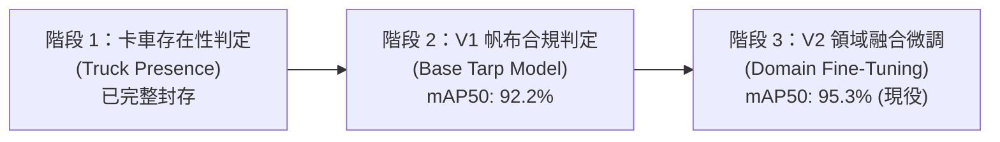

# 專案現況與進度完整說明報告 (Project Status & Progress Report)

**更新日期**：2026-10-25  
**專案名稱**：卡車/砂石車車斗帆布覆蓋合規性即時判定系統 (Dump Truck Tarp Coverage Detection)  
**當前版本**：**V2 (Domain Fine-Tuned)**  
**核心權重**：[`weights/best_tarp_v2.pt`](weights/best_tarp_v2.pt) (mAP@50 = **95.3%**)  
**GitHub 專案庫**：[Yiwen86/dump-truck-tarp-vision](https://github.com/Yiwen86/dump-truck-tarp-vision)

---

## 📌 一、專案目標與演進歷程

本專案旨在利用深度學習電腦視覺技術（YOLOv8），針對道路與路口監視器（CCTV）影像，**即時、自動化判定砂石車與大型卡車車斗上方「帆布是否有依規定覆蓋」**，以杜絕砂石散落、揚塵污染及交通安全隱患。

### 專案演進三大階段：


1. **第一階段（已封存）**：舊版「卡車存在判定（Presence Detection）」系統，包含特定車型檢測與虛擬線圈（Virtual Loop）觸發機制，現已完整歸檔收納於 [`legacy_truck_presence/`](legacy_truck_presence/)。
2. **第二階段（V1 基準）**：轉向「帆布覆蓋合規性判定」，將 4 類別簡化為核心 2 類別，在 2,674 張標註影像上訓練出首版模型 [`weights/best_tarp_v1.pt`](weights/best_tarp_v1.pt)（mAP@50 達 92.2%）。
3. **第三階段（V2 現役）**：針對台灣路口真實監視器俯視視角，匯入 57 張高品質人工標註影像，實施**分層抽樣（Stratified Split）與特徵融合微調（Data Fusion）**，產出最新的 [`weights/best_tarp_v2.pt`](weights/best_tarp_v2.pt)，**mAP@50 飆升至 95.3%**。

---

## 🎯 二、核心辨識類別與合規判定邏輯

模型專注於定位「車斗區域」並即時進行狀態分類：

| 類別 ID | 類別名稱 | 意義說明 | 畫面標註邊框 | 執法判定狀態 |
| :---: | :--- | :--- | :---: | :---: |
| **`0`** | **`covered`** | 帆布完整覆蓋車斗（含正常覆蓋與高凸覆蓋） | 🟢 綠色邊框 | **[COMPLIANT] 合格** |
| **`1`** | **`uncovered`** | 車斗裸露、未蓋帆布、砂石土石直接外露 | 🔴 紅色邊框 | **[VIOLATION] 違規** |

* **畫面合規邏輯**：單張畫面若檢測出任一 `uncovered` 車斗，即判定為 `NON_COMPLIANT`（違規），並記錄最大信心度。

---

## 📊 三、模型效能評估與成果比較 (RTX 4060 GPU 加速)

### 1. V1 基準 vs V2 升級版 指標對比

| 評估項目 | V1 基準模型 (`best_tarp_v1.pt`) | 🌟 **V2 現行最優模型 (`best_tarp_v2.pt`)** | 升級幅度 |
| :--- | :---: | :---: | :---: |
| **總體 mAP@50 (核心合規指標)** | 92.2% | **🔥 95.3%** | **+3.1%** |
| **召回率 (Recall，抓違規關鍵)** | 86.4% | **🎯 91.0%** | **+4.6%** |
| **精確率 (Precision)** | 85.0% | **87.9%** | **+2.9%** |
| 🟢 **`covered` (有蓋合格) mAP@50** | 93.9% | **🌟 97.2%** | **+3.3%** |
| 🔴 **`uncovered` (未蓋違規) mAP@50** | 90.5% | **🌟 93.5%** | **+3.0%** |
| **mAP@50-95 (嚴苛邊框貼合度)** | 68.9% | **73.4%** | **+4.5%** |
| **單張推論延遲** | ~1.5 ms (~660 FPS) | **~1.5 ms (~660 FPS)** | 維持即時極速 |

### 2. 57 張真實路況俯視圖實測驗證
針對監視器真實俯視視角進行批次實測（結果見 [`runs/v2_eval_real_overhead/`](runs/v2_eval_real_overhead/)）：
* **真實樣本標註**：`uncovered` 50 張 / `covered` 7 張
* **V2 檢測成果**：
  * **違規判定 (NON_COMPLIANT)**：48 張
  * **合格判定 (COMPLIANT)**：8 張
  * **未檢出 (NONE)**：僅 1 張
* **真實場景檢出率達到 98.2% (56/57)**，精準解決俯視角漏檢與低信心問題。

---

## 📁 四、資料集架構 (Datasets: 單一標準資料集 + 完整歷史封存)

專案現已全面收斂為單一標準資料集，歷史資料妥善歸檔：

1. **[`dataset/`](dataset/) (現行唯一標準資料集，共 2,731 張影像)**：
   * `train/`：**1,917 張**（原 1,868 + 新 46 分層抽樣樣本）
   * `valid/`：**546 張**（原 534 + 新 11 分層抽樣樣本）
   * `test/`：**268 張**（獨立保留作為基準測試集）
   * `raw_overhead_57/`：完整保存外部匯入之 57 張原始原圖與標註檔，確保資料可溯源。
   * `data.yaml`：標準 YOLOv8 配置檔。
2. **[`archive/03_v1_dataset_backup/`](archive/03_v1_dataset_backup/)**：
   * 完整封存早期 V1 獨立資料集（2,674 張），確保歷程不遺失。
3. **[`archive/02_curation_pool_767/`](archive/02_curation_pool_767/) (精華圖片篩選池，共 767 張去重影像)**：
   * `previews/`：附帶綠框/紅框的視覺化快速預覽圖，供肉眼直觀篩選。
   * `selected/`：供使用者存放未來額外挑選出的精華影像，可隨時擴充訓練集。

---

## 🗃️ 五、核心模型權重庫 (`weights/`)

| 檔案名稱 | 參數量 / 大小 | 狀態 | 說明 |
| :--- | :---: | :---: | :--- |
| [`weights/best.pt`](weights/best.pt) | 3.1M 參數 / 6.5 MB | **🔥 唯一主力** | 現役最優模型 (mAP50=95.3%)，各主線腳本與 Web 預設調用 |
| [`weights/archive/`](weights/archive/) | -- | 歷程封存 | 收納 `best_tarp_v2.pt`、`best_tarp_v1.pt`、`yolov8n.pt`、`yolo26n.pt` 等過往權重 |

---

## 🛠️ 六、主線工作流腳本清單 (`src/`)

主線腳本精煉為 3 大核心工具，其餘輔助與歷史腳本歸檔：

```text
src/
├── train.py                          # [核心] 一鍵訓練 / 微調最新模型 (自動輸出至 runs/train 與 weights/best.pt)
├── detect.py                         # [核心] 一鍵端到端推論 (支援單圖/目錄/自動產出 CSV 報表)
├── app_demo.py                       # [展示] 現代化 Flask Web 即時互動展示系統
└── tools/                            # [工具]
    ├── extract_unique_767.py         # 767 張基底去重原圖提煉工具
    └── build_dataset_from_selected.py# 挑選圖片一鍵轉資料集工具
```
*(歷史階段性腳本 01, 02, 03, 06, 07 全數保存於 [`archive/history_scripts/`](archive/history_scripts/))*

---

## 💻 七、系統操作與指令指南

### 1. 啟動 Web 視覺化互動系統
```bash
.venv\Scripts\python.exe src/app_demo.py
```
* 開啟瀏覽器訪問 `http://127.0.0.1:5000`。
* 支援**拖曳本機圖片、切換 4 組快速範例（含台灣真實俯視路況）、即時調整信心度門檻（預設 0.30）**。
* 系統啟動時已預設載入 `weights/best.pt`。

### 2. 執行批次 / 單張推論與報表導出
```bash
# 批次判定指定資料夾內的圖片 (使用 GPU 加速，預設調用 weights/best.pt)
.venv\Scripts\python.exe src/detect.py --input <資料夾路徑> --output_dir runs/detect --device 0

# 測試真實路況 57 張俯視樣本
.venv\Scripts\python.exe src/detect.py --input dataset/raw_overhead_57 --output_dir runs/eval_overhead --device 0
```
* 每次推論會在輸出目錄自動生成：
  * 標註邊框圖檔 (`pred_*.jpg`)
  * 合規性統計清單 (`tarp_compliance_summary.csv`)

### 3. 一鍵重新微調/訓練模型
```bash
.venv\Scripts\python.exe src/train.py
```
* 自動調用 RTX 4060 GPU 進行自適應領域微調，並自動將最優模型更新至 `weights/best.pt`。

---

## 📦 八、歷史檔案封存說明 (`legacy_truck_presence/`)

為保持主線專案架構精煉，先前的「卡車存在判定（Presence）」研究資產已完整封裝歸檔：
* `legacy_truck_presence/src/`：舊有腳本 `04_predict_custom_yolo.py`, `05_virtual_loop_detector.py`, `06_batch_evaluate_schemes.py`, `07_live_virtual_loop.py`
* `legacy_truck_presence/data/` & `dataset/`：舊道路監控原始資料與存在性標註
* `legacy_truck_presence/runs/`：舊檢測線圈圖表與模型比較報告
* 詳情可參閱 [`legacy_truck_presence/README.md`](legacy_truck_presence/README.md)。

---

## 🔮 九、未來展望與接續發展建議

1. **即時 RTSP / CCTV 串流接入**：
   * 將現行圖片推論引擎封裝為串流監控背景任務，接入路口 RTSP 串流即時取流分析。
2. **線圈觸發 / ROI 區域最佳化**：
   * 結合舊系統的「虛擬線圈（Virtual Loop）」邏輯，僅當砂石車駛入最佳判定範圍時觸發拍照判定，降低運算負擔並避免重複開罰。
3. **主動式學習（Active Learning）精煉**：
   * 若於實際路況遇到極端天候（如大雨、夜間、眩光）之誤判樣本，可直接放入 [`curation_pool_767/selected/`](curation_pool_767/selected/)，使用 `05_build_dataset_from_selected.py` 進行下一輪迭代。
